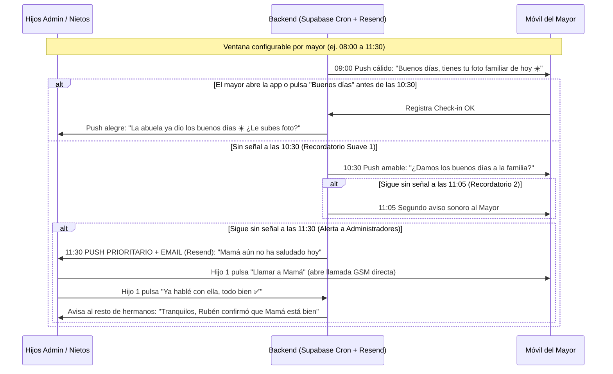
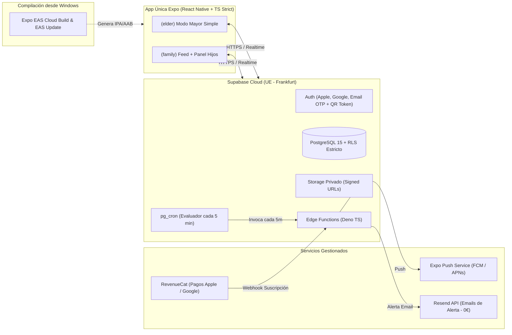
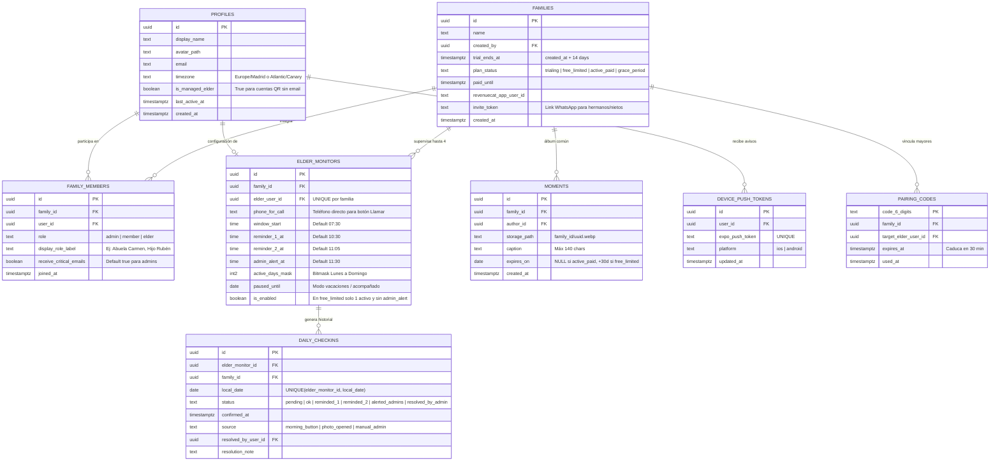

# Blueprint Maestro Definitivo: **"Cerca"** _(v2.0 — Decisiones Cerradas)_

> [!IMPORTANT]
> **Fuente Única de Verdad (SSOT) del Proyecto:** Este documento recoge todas las decisiones de producto, alcance, arquitectura, negocio y plazos cerradas por los dos socios fundadores. Está diseñado para copiarse directamente en la raíz del repositorio como `CONTEXT.md` (junto con `AGENTS.md`) para que cualquier IA de programación trabaje con contexto completo, sin inventar funcionalidades fuera de alcance ni romper la arquitectura.

---

## 1. Ficha de Contexto Real del Equipo y Restricciones Operativas

- **Equipo fundador:** 2 desarrolladores con base en JavaScript/TypeScript/Web apoyados intensivamente en IA.
- **Dedicación real:** **15–20 horas/semana por socio** (~35 h/semana conjuntas), compaginando con estudios/trabajo.
- **Entorno de desarrollo:** **Windows** (sin Mac local), probando en dispositivos físicos iPhone y Android mediante **Expo EAS Cloud Builds**.
- **Punto de partida administrativo:** Inicio como particulares desde cero (sin S.L. ni cuentas previas en tiendas).
- **Meta de negocio:** Aplicación B2C nacional (nacida en Granada y escalada a toda España) con objetivo inicial de **10.000 usuarios activos (~2.200 familias)**.

---

## 2. Visión de Producto y Posicionamiento Legal

### 2.1 El "Caballo de Troya Emocional"

Las personas mayores autónomas (65–82 años) rechazan pulseras o apps que les hagan sentir vigiladas o enfermas, pero **adoran ver fotos cotidianas de sus hijos y nietos**.

- **Para el Mayor (`elder`):** Es una app ultra limpia en su smartphone habitual (sin sustituir su menú ni bloquearle WhatsApp). Entra al tocar la notificación matutina, ve en grande la foto del día con su texto, pulsa el botón gigante **«Dar los buenos días ☀️»** y sale con normalidad.
- **Para los Hijos (`admin`):** Debajo del saludo matutino opera un **motor invisible de tranquilidad**. Si llega la hora límite configurada por la familia (ej. 11:30 h) y un mayor no ha dado señal de vida, el sistema recuerda primero con cariño al mayor y, solo si sigue sin interactuar, envía **Alerta Push Prioritaria + Email inmediato** a los hijos administradores con botón directo para llamarle por teléfono.

### 2.2 Blindaje Regulatorio (España / UE)

- **No es Producto Sanitario (AEMPS / MDR) ni servicio de emergencias 112:** Se comercializa y redacta legalmente como **«Red privada de conexión familiar diaria y bienestar cotidiano»**. Prohibido usar terminología clínica ("diagnóstico", "monitorización médica", "teleasistencia sanitaria de urgencia").
- **RGPD desde el diseño:** Base de datos y almacenamiento 100% en la **Unión Europea** (`eu-central-1` Frankfurt), fotos privadas servidas exclusivamente con _Signed URLs_ temporales y borrado completo de cuenta/familia en 1 clic.

---

## 3. Especificación Funcional Cerrada (Alcance Estricto MVP v1.0)

### 3.1 Roles dentro de un Grupo Familiar (Multi-Mayor soportado)

Una sola suscripción familiar cubre **hasta 4 mayores** (ej. Abuelo y Abuela cada uno con su móvil, o padres y suegros) y **hasta 10 familiares**:

| Rol                     | Quién es                              | Acceso / Login                                                                                     | Experiencia en la App                                                                                                                           |
| :---------------------- | :------------------------------------ | :------------------------------------------------------------------------------------------------- | :---------------------------------------------------------------------------------------------------------------------------------------------- |
| **`elder` (Mayor)**     | Hasta 4 mayores autónomos por familia | **Sin email ni contraseña:** Código QR o código numérico gigante de 6 dígitos generado por el hijo | **Pantalla Única Ultra-Simple:** Foto del día, texto grande (`>= 22pt`), botón gigante _«Buenos días ☀️»_ (`>= 64dp`) y ajustes ocultos.        |
| **`admin` (Hijo/a)**    | Hijos adultos (pagadores/gestores)    | **Sin contraseñas:** Sign in with Apple + Google Sign-In + Email OTP (código 6 dígitos)            | **Feed Familiar + Panel de Tranquilidad:** Estado individual de cada mayor, subida de fotos, alertas y **configuración remota de los mayores**. |
| **`member` (Familiar)** | Nietos, hermanos, sobrinos            | Sign in with Apple + Google Sign-In + Email OTP                                                    | **Feed Familiar Social:** Subir fotos cotidianas, ver si los abuelos ya saludaron y recibir aviso cuando el abuelo da los buenos días.          |

### 3.2 Los 5 Flujos Exactos del MVP (v1.0)

1. **Vinculación Instantánea y Configuración 100% Remota:**
   - El hijo crea el grupo familiar, da de alta el perfil de su madre/padre (nombre, teléfono para llamada rápida y horarios) y vincula el móvil del mayor con un QR o código de 6 cifras.
   - Si hay que cambiar la hora límite de aviso o activar el _"Modo Acompañado / Vacaciones"_ (pausa temporal de alertas cuando el abuelo duerme en casa de sus hijos), **lo cambia el hijo desde su móvil** sin que el mayor tenga que tocar ningún menú.
2. **Formato Multimedia Limpio (Solo Foto + Pie de Foto en v1.0):**
   - Hijos y nietos suben fotos desde cámara o galería con un texto corto cariñoso (máx. 140 caracteres).
   - La app comprime la imagen en el propio teléfono antes de subirla (`WebP/JPEG`, lado máx. `1280px`, peso `<= 180 KB`). **Cero vídeos y cero audios en la v1.0** para minimizar costes de servidor y complejidad en dispositivos.
3. **Bucle "Anti-Días Vacíos" (Retención Bidireccional):**
   - Si a las 09:00 h alguien ya subió foto nueva hoy, el mayor ve la foto nueva.
   - **Si ningún familiar se ha acordado de subir foto esa mañana**, el mayor ve un **recuerdo aleatorio del álbum familiar** (_«Recuerdo familiar de hace unos días 💛»_) junto a su botón _«Dar los buenos días ☀️»_.
   - En cuanto el mayor pulsa _«Buenos días»_, la app envía una notificación cálida a hijos y nietos: _«La abuela Carmen os acaba de dar los buenos días ☀️. ¡Mándale una foto rápida de tu mañana!»_.
4. **Protocolo Escalonado de Tranquilidad (Cero Falsas Alarmas):**
   - **Señal de vida válida (`status = ok`):** Pulsar _«Buenos días ☀️»_ o abrir la app y visualizar la foto durante la ventana matutina marca automáticamente el día como confirmado para ese mayor.
   - Si no hay señal, el motor evalúa cada mayor por separado según su horario:



5. **Freemium Ético + Retención Inteligente de Fotos:**
   - **14 días iniciales con TODO desbloqueado sin pedir tarjeta** al registrarse (maximiza la invitación viral por WhatsApp a toda la familia).
   - **A partir del día 15 sin suscripción (Modo Gratis):** El mayor **NUNCA queda bloqueado** (sigue viendo 1 foto al día y dando los buenos días). Sin embargo: (1) se desactivan las **Alertas Automáticas de Tranquilidad** para los hijos, (2) solo permite 1 mayor activo, y (3) las fotos en la nube **caducan a los 30 días** (un cron nocturno limpia medios > 30 días de familias gratuitas).
   - **Plan Familiar Completo (4,99 €/mes o 39,99 €/año):** Un solo pago desbloquea para toda la familia: alertas automáticas Push + Email, hasta 4 mayores monitorizados y **Álbum Histórico Familiar ilimitado** en la nube.

### 3.3 Hoja de Mejoras Post-Lanzamiento (Fuera del MVP — Prohibido tocar antes de publicar v1.0)

- **Versión 1.1 (Mes 2):** **Recordatorios de pastillas/hábitos con audio grabado por los nietos** + **Alertas de respaldo por SMS (Twilio)** para suscriptores de pago.
- **Versión 1.2 (Mes 3):** Widgets de pantalla de inicio para iOS y Android (`expo-apple-targets` compilado vía EAS Cloud) + notas de voz en saludos.

---

## 4. Arquitectura Técnica Optimizada para Windows + 2 Devs

> [!WARNING]
> **Restricción Crítica de Entorno Windows:** Al no disponer de Mac físico, **queda prohibido en la v1.0 añadir código nativo Swift/Objective-C manual o extensiones Xcode complejas** que requieran depuración local en macOS. Toda librería elegida debe ser 100% compatible con **Expo Managed Workflow + EAS Cloud Build**.

### 4.1 Stack Definitivo



- **App Móvil:** **Expo SDK actual + React Native + TypeScript (`strict: true`) + Expo Router**.
- **UI & Estilos:** **NativeWind v4** con dos escalas de tokens separadas (`ui-elder` con botones `>= 64dp` y tipografía `>= 22px`, y `ui-family`).
- **Estado y Caché:** **TanStack Query v5** persistido en **`react-native-mmkv`** (carga instantánea de la última foto aunque el mayor tenga mala cobertura) + **Zustand** mínimo.
- **Backend y Base de Datos:** **Supabase (Frankfurt `eu-central-1`)** con PostgreSQL, RLS obligatorio, Supabase Storage privado (con opción de migrar almacenamiento masivo a Cloudflare R2 más adelante sin cambiar la lógica de la app) y Edge Functions.
- **Emails Críticos de Alerta:** **Resend** invocado desde la Edge Function de alertas (capa gratuita incluye 3.000 emails/mes; coste 0 € en lanzamiento).
- **Suscripciones Móviles:** **RevenueCat** (`react-native-purchases`), compatible con Expo Development Builds generados desde Windows con EAS.
- **Observabilidad:** **Sentry** (`@sentry/react-native`) + **PostHog EU** (analítica de producto).

---

## 5. Modelo de Datos Relacional (PostgreSQL + Multi-Mayor)



---

## 6. Reglas Anti-Caos para Trabajo en Pareja con IA (`AGENTS.md`)

Estructura obligatoria del repositorio y reglas que se guardarán en `AGENTS.md` desde el primer commit:

```text
cerca/
├── AGENTS.md                        # Reglas estrictas de arquitectura para cualquier IA
├── CONTEXT.md                       # Copia íntegra de este Blueprint Maestro
├── app/                             # Expo Router (SOLO enrutado, cero lógica de negocio)
│   ├── (public)/                    # Bienvenida, Login Apple/Google/OTP, Pantalla Código 6 dígitos Mayor
│   ├── (elder)/                     # Pantalla única bloqueada de alta accesibilidad
│   └── (family)/                    # Tabs: Inicio/Tranquilidad, Subir Foto, Álbum, Ajustes Mayores
├── src/
│   ├── features/
│   │   ├── auth-pairing/            # Login familiar + generación/canje de QR y código de 6 dígitos
│   │   ├── checkin-engine/          # Botón Buenos Días, tarjetas de estado vivo, confirmar llamada
│   │   ├── moments/                 # Compresor WebP <=180KB, subida, foto del día + recuerdo fallback
│   │   ├── elder-config/            # Configuración remota de horarios/vacaciones de hasta 4 mayores
│   │   └── subscription/            # Estado Trial 14d, Freemium y Paywall con RevenueCat
│   └── shared/
│       ├── api/                     # Cliente Supabase + database.types.ts autogenerado
│       ├── ui-elder/                # Botones >=64dp, textos >=22px, alto contraste AAA
│       ├── ui-family/               # Componentes limpios y cálidos para hijos/nietos
│       └── utils/                   # Fechas por zona horaria, compresión de imagen, Sentry
└── supabase/
    ├── migrations/                  # Archivos SQL secuenciales + políticas RLS completas
    └── functions/
        ├── redeem-pairing-code/     # Canjea código 6 dígitos y emite sesión duradera al Mayor
        ├── evaluate-checkins/       # Cron cada 5 min: envía avisos y alertas Push + Resend Email
        ├── cleanup-expired-media/   # Cron diario 04:00 UTC: borra fotos >30d de cuentas free_limited
        └── revenuecat-webhook/      # Sincroniza active_paid / free_limited en tabla families
```

### Reglas Inquebrantables para la IA (`AGENTS.md`):

1. **Compatibilidad Windows + EAS Managed:** Prohibido instalar paquetes nativos obsoletos o escribir código nativo manual que exija abrir Xcode en macOS. Todo paquete nuevo se instala con `npx expo install`.
2. **Base de Datos = Migraciones + Tipos:** Prohibido alterar tablas fuera de `supabase/migrations/*.sql`. Tras cada migración se ejecuta `supabase gen types typescript` para actualizar `database.types.ts`.
3. **Prohibido `supabase.from()` en componentes UI:** Toda llamada a datos vive en `src/features/<modulo>/api.ts` y pasa por hooks de TanStack Query.
4. **Archivos pequeños y mantenibles:** Ningún archivo `.ts` o `.tsx` puede superar las **250 líneas**. Si crece más, se divide en subcomponentes o funciones puras.
5. **Idempotencia en `evaluate-checkins`:** Usar `UPDATE ... WHERE status = ... RETURNING *` para que dos ejecuciones del cron jamás disparen emails o notificaciones duplicadas a los hijos.
6. **Validación estricta:** Todo input en Edge Functions se valida con `Zod`.

### División Limpia entre los 2 Socios (15–20h/sem cada uno)

- **Socio A (Backend, Fiabilidad & Pagos):** Migraciones SQL + RLS, Edge Functions (`redeem-pairing-code`, `evaluate-checkins`, `cleanup-expired-media`, `revenuecat-webhook`), integración de Resend + Expo Push y configuración de cuentas Apple/Google/RevenueCat.
- **Socio B (App Móvil, Accesibilidad & Contenido):** `ElderShell` ultra accesible, `FamilyShell`, flujo de cámara + compresión `<=180KB`, lógica de recuerdo aleatorio anti-días vacíos, invitaciones virales a WhatsApp y grabación de piezas para TikTok/Reels.

---

## 7. Calendario Realista de 6 Semanas (A 15–20h/semana por Socio)

> [!CAUTION]
> **Regla de los 14 días de Google Play (¡Vital!):** Las cuentas personales nuevas en Google Play tienen bloqueada la subida a Producción hasta completar **14 días seguidos de Prueba Cerrada con al menos 12 testers reales con Android**. Por eso la primera versión funcional se sube a Prueba Cerrada en la **Semana 3**, haciendo que el reloj de 14 días de Google corra en paralelo mientras termináis los pagos en las Semanas 4 y 5.

| Semana       | Trabajo Técnico (~35h conjuntas/sem)                                                                                                                                                                                                | Hitos Administrativos, Testing y Marketing                                                                                                                                                                |
| :----------- | :---------------------------------------------------------------------------------------------------------------------------------------------------------------------------------------------------------------------------------- | :-------------------------------------------------------------------------------------------------------------------------------------------------------------------------------------------------------- |
| **Semana 1** | Crear repo + `AGENTS.md` + Supabase EU. Migración inicial SQL + RLS. Login sin contraseña (Apple/Google/Email OTP) y vinculación del Mayor por QR / 6 dígitos. Primer _Development Build_ en la nube con EAS para vuestros móviles. | Cerrar nombre definitivo y dominio. **Día 1-2: Pagar y verificar cuentas Google Play (25 €) y Apple Developer (99 €)**. Abrir TikTok/IG/Shorts de la marca.                                               |
| **Semana 2** | **Modo Mayor (`ElderShell`)** + Compresión y subida de fotos + Bucle _«Buenos días ☀️»_ + Sistema de recuerdo familiar cuando no hay foto nueva + Push de vuelta a los nietos.                                                      | Enseñar el prototipo funcionando en vuestros móviles a **5 abuelos cercanos en Granada** para validar tamaño de botones, contraste y entendimiento a la primera.                                          |
| **Semana 3** | Panel de configuración remota multi-mayor (hasta 4) + Motor `evaluate-checkins` (`pg_cron` 5 min) + Alertas Push + Email con **Resend** + Botón _«Ya hablé con ella ✅»_.                                                           | **HITO CRÍTICO:** Subir build alfa a **Google Play Prueba Cerrada** e invitar a **15 amigos/familiares con Android** para activar la cuenta atrás obligatoria de 14 días de Google (y TestFlight en iOS). |
| **Semana 4** | Flujo viral de invitación a hermanos/nietos por WhatsApp + Lógica de Trial 14 días sin tarjeta + Cron de limpieza de fotos (>30 días en modo gratis) + Integración de **RevenueCat**.                                               | Los 15 testers reales usan la app a diario con sus padres/abuelos en Granada. Publicar los **primeros 3–4 vídeos "construyendo en público"** desde Granada.                                               |
| **Semana 5** | Paywall ético del Día 15, borrado de cuenta en 1 clic (exigido por Apple), pulido de errores detectados en Sentry, capturas de tienda (ASO) y textos legales RGPD.                                                                  | Se cumplen los **14 días de Google Play** -> solicitar desbloqueo de Producción en Google y enviar versión 1.0 a revisión oficial de Apple App Store.                                                     |
| **Semana 6** | **Lanzamiento Público Nacional v1.0** en iOS y Android. Monitorización de métricas en PostHog (tasa de vinculación del abuelo y conversión al día 14).                                                                              | Ofensiva orgánica en TikTok/Reels + nota de prensa a _Ideal de Granada_, _Granada Hoy_, radios locales y _Canal Sur_ (_«Dos jóvenes de Granada crean una app contra la soledad de los mayores»_).         |

---

## 8. Economía y Estrategia hacia los 10.000 Usuarios

### 8.1 Los Números Reales del MVP

- **Captación apalancada:** Cada hijo campeón que crea una familia invita por WhatsApp a una media de 3,5 personas (hermanos, nietos y abuelos). **Llegar a 10.000 usuarios activos solo exige captar a ~2.200 familias**.
- **Coste técnico mensual con 10.000 usuarios:** **~35 € – 50 €/mes totales** (Supabase Pro 25 € + dominio/almacenamiento comprimido WebP con purga automática a los 30 días en cuentas gratuitas; Resend, Sentry, PostHog y RevenueCat en tramo de 0 €).
- **Ingresos netos recurrentes estimados con 2.200 familias activas:** Entre **1.400 €/mes y 3.250 €/mes limpios** (descontado el 15% de Apple/Google Small Business Program). Al escalar de 2.200 a **10.000 familias** en toda España, el margen neto sube a **6.200 € – 14.500 €/mes** sin apenas incrementar costes fijos.

### 8.2 Guiones Ganadores para Redes (Dando la Cara desde Granada)

1. **El Vídeo Fundacional (Fijado en el perfil):** Plano cercano y natural en Granada: _«Ayer nos cerraron la puerta en 30 negocios seguidos, así que nos sentamos a pensar qué problema de verdad sufren nuestras propias familias. Mi abuela vive sola, odia las pulseras para mayores, pero se le ilumina la cara cuando ve una foto nuestra...»_ -> enseñar los dos móviles funcionando en tiempo real.
2. **Demostración en 15 segundos con un Abuelo Real:** Grabar las manos y la sonrisa de un abuelo real abriendo la foto de la mañana y pulsando el botón amarillo gigante, mostrando cómo en ese mismo segundo a su hija le salta en el trabajo: _«Mamá ya os ha dado los buenos días ☀️»_.
3. **Ángulo "Hijos lejos de casa":** Contenido directo para quienes viven en Madrid, Málaga, Barcelona o fuera de España teniendo a sus padres mayores en Granada o en pueblos de toda España.

---

## 9. Checklist de Arranque Inmediato (Primeras 48 Horas)

1. **Elegir nombre final libre:** Comprobar en App Store, Google Play y dominios `.es` / `.app` variantes cortas y cálidas (ej. _Cerca_, _AlDía_, _Lazo_, _Solana_, _Contigo_).
2. **Darse de alta hoy mismo en Google Play Console (25 €) y Apple Developer Program (99 €):** Activar también el _Apple App Store Small Business Program_ y la reducción al 15% de Google Play para no pagar el 30% de comisión.
3. **Crear organización gratuita en GitHub, proyecto en Supabase (Región `eu-central-1` Frankfurt) y cuenta en Expo (`expo.dev`).**
4. **Inicializar el repositorio con IA:** Colocar este documento como `CONTEXT.md` en la raíz de vuestra carpeta de proyecto y lanzar el primer paso de estructuración y creación de `AGENTS.md` sin escribir lógica desordenada.
